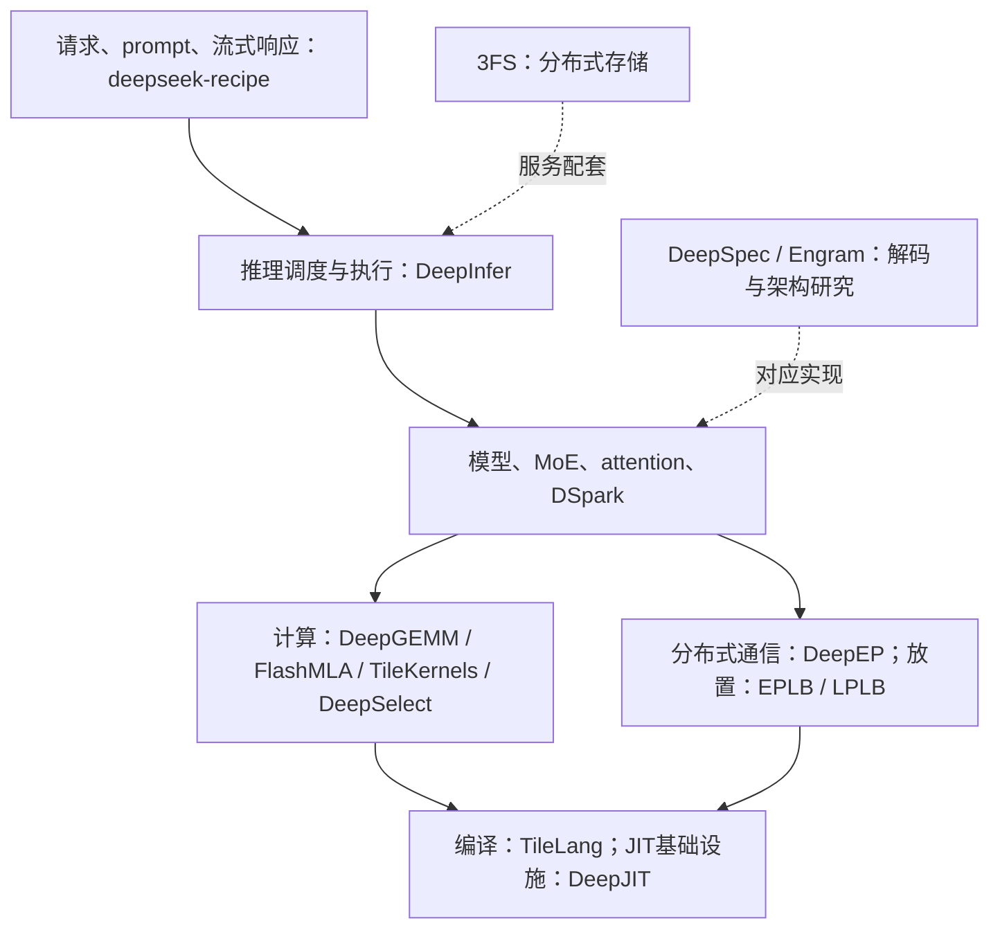

# DeepSeek推理开源栈：源码地图、学习顺序与4060落地判断

核查日期：2026-10-22。对象：Windows原生llama.cpp b11429、DeepSeek-V4-Flash preview混合量化GGUF约155GB、RTX4060 Laptop/Ada SM89/8GB显存、32GB RAM。本文是源码研究，不是部署或加速实测。[硬件盘点](../case-studies/low-vram-inference/00-hardware-inventory.md) · [已有实验](../case-studies/low-vram-inference/01-experiments-and-results.md) · [八周计划](../case-studies/low-vram-inference/02-open-source-learning-roadmap.md)。

**结论：DeepInfer是很好的推理系统教材，但当前发布版不能直接用于这台机器；TileLang本体适合后续做SM89小算子实验，DeepSeek现成高性能kernel大多面向SM90/100或Ascend950。安装这些Python包不会自动加速已有llama.cpp。** 对当前155GB模型，仍要先测CPU专家、SSD分页和GPU算子的时间占比，再决定值得移植什么。

## 1．名称、范围与已克隆源码

正式名称是 **DeepInfer**（`deepseek-ai/DeepInfer`）；另有 **DeepEP** 通信库，二者不同。**TileLang** 位于 `tile-ai/tilelang`，是独立组织维护的kernel语言/编译器；DeepSeek使用它编写TileKernels和部分DeepInfer算子。TileLang致谢列出初始开发团队及PKU/MSR背景，不能概括为DeepSeek独有语言。[tilelang](https://github.com/tile-ai/tilelang/blob/43f13c7ad1d1c9a890f2b9d3b46d7b1f3e1b695f/README.md)

本轮读取[DeepSeek官方GitHub组织完整公开仓库列表](https://api.github.com/orgs/deepseek-ai/repos?per_page=100&type=public)，共45个，逐项分类：14个推理基础设施、7个邻接研究/工具、18个模型参考、6个应用/目录类。克隆前3类39个，再加TileLang本体与Ascend适配器，**共41个源码仓库**。这里的“全量”限于当日公开GitHub组织及直接相关TileLang入口，不声称覆盖所有HF模型、私有服务或第三方fork。

本地根目录：`/Users/mark/Documents/Github/deepseek-inference-sources/`，约907MiB（`du -sh`口径）。目录按 `deepseek-ai/<repo>`、`tile-ai/<repo>`分组，没有嵌套进本研究仓库，也没有复制到Windows推理环境。

[完整清单与复现manifest](../case-studies/artifacts/low-vram-inference/deepseek-open-source-20261022.json)记录所有47条目录项、分类、来源URL、41个HEAD、路径、license元数据及gitlink依赖版本。本地另存 `inventory.json`、`clone-results.json`。关键快照：

| 源码 | 本轮HEAD（缩写；完整值见manifest） |
| --- | --- |
| deepseek-ai/DeepInfer | `9bd9cf243fc5` |
| tile-ai/tilelang | `43f13c7ad1d1` |
| deepseek-ai/DeepGEMM | `5081f8513af5` |
| deepseek-ai/DeepEP | `f6aa38fe06cd` |
| deepseek-ai/FlashMLA | `0f11e178da1f` |
| deepseek-ai/TileKernels | `c1cf914a82e6` |
| deepseek-ai/DeepSelect | `bfa4507d935f` |
| deepseek-ai/DeepJIT | `18fe520b0473` |
| deepseek-ai/DeepSpec | `005e03b81cec` |

克隆使用 `--depth 1 --filter=blob:none`、`GIT_LFS_SKIP_SMUDGE=1`，未初始化submodule；独立克隆的main不等于DeepInfer所pin的vendor组合。需要构建时必须以目标项目gitlink和依赖锁定为准，不能把本轮各自最新HEAD拼起来就称兼容。41个工作区均检查干净；DreamCraft3D本体克隆成功，但其`extern/MVDream`缺少`.gitmodules`映射，submodule状态枚举报错，已在manifest保留，未尝试修复上游。

本轮没有执行build/install、初始化vendor、下载HF权重、运行模型或GPU benchmark。DeepInfer offline示例会自动下载默认新checkpoint，因此未用“跑一下”验证兼容。

## 2．这些项目分别位于哪一层



图是职责地图，不表示每个库都经由TileLang编译：DeepGEMM/DeepEP也有原生CUDA与DeepJIT路径。**runtime、kernel、编译器、通信、存储和模型架构是不同替换层。**

### 推理基础设施：14项

“不能直接用”指当前发布源码与现有架构组合，不是说算法永远不能移植。

| 项目与固定来源 | 研究内容 | 对当前机器的判断 |
| --- | --- | --- |
| [DeepInfer](https://github.com/deepseek-ai/DeepInfer/blob/9bd9cf243fc53ef9afbf8f04d391d989117d6ab9/README.md) | 调度、模型执行、DSpark、SWA bounded replay、DP/CP/EP、结构化输出 | **不直接部署**：SM100/Ascend950、V4.1-Flash、Linux；与SM89、旧preview/GGUF、Windows基线均不匹配 |
| [DeepGEMM](https://github.com/deepseek-ai/DeepGEMM/blob/5081f8513af57e61696de4f4f04b0e707ffb503e/README.md) | FP8/FP4/BF16 GEMM、grouped/masked MoE、MQA scoring、MegaMoE、HC | README要求SM90/SM100、CUDA≥12.9、C++20；**无当前SM89支持路径**。矩阵布局/scale不是任意GGUF Q4布局 |
| [FlashMLA](https://github.com/deepseek-ai/FlashMLA/blob/0f11e178da1f67becb087a324b400854931ec3e3/README.md) | attention、低精度KV、融合norm/RoPE/attention/cast | 当前SM100/SM103、CUDA≥13.1；**不支持SM89且不兼容旧V4缓存格式**，见下节 |
| [TileKernels](https://github.com/deepseek-ai/TileKernels/blob/c1cf914a82e6901c679445f872051ce44ac2cc63/README.md) | MoE路由、量化、Engram、mHC、RoPE等TileLang算子；附torch参考实现 | 要求SM90/100、CUDA≥13.1、Python≥3.12、PyTorch≥2.13、TileLang≥0.1.15；**语言支持Ada≠这套算子支持Ada** |
| [DeepSelect](https://github.com/deepseek-ai/DeepSelect/blob/bfa4507d935f17ebfc3d0f00ff7d3c9a4d0e5c18/README.md) | DSA indexer与sampler TopK、radix选择与访存优化 | README未明确SM表，但[固定构建脚本](https://github.com/deepseek-ai/DeepSelect/blob/bfa4507d935f17ebfc3d0f00ff7d3c9a4d0e5c18/setup.py)仅编译sm100a/103a；**默认构建不支持4060**。2–20倍为特定算子相对torch.topk，非模型倍速 |
| [DeepEP](https://github.com/deepseek-ai/DeepEP/blob/f6aa38fe06cd4a0489e7730365d4e0114970a2f3/README.md) | 当前称DeepEveryParallel；EP dispatch/combine，及PP/CP/DP、Engram等通信 | Linux、Hopper+、CUDA≥13.1、PyTorch≥2.10/NCCL；**SM89与单卡均不是目标路径**，不能替代SSD→RAM分页 |
| [EPLB](https://github.com/deepseek-ai/EPLB/blob/d52c72d5b2f2fb4c41afbf8eb21366820239913d/README.md) | 根据专家负载复制/放置专家，平衡多GPU工作 | 可离线学算法；本机没有多GPU EP负载可均衡，专家复制还增加内存，不是分页缓存 |
| [LPLB](https://github.com/deepseek-ai/LPLB/blob/0490f79452f7ef277e814449600b1b1dd4c663b3/README.md) | 线性规划、拓扑副本与动态token分配；仍属早期研究 | CUDA≥12.6.3和MathDx依赖；多卡问题，与单卡SSD offload不同，暂不部署 |
| [DeepJIT](https://github.com/deepseek-ai/DeepJIT/blob/18fe520b0473fc45d32d2f0e86923da707de19ab/README.md) | C++20 header-only kernel编译、二进制缓存、加载与launch | Linux；CUDA头≥12.4、nvcc≥12.9、PyTorch ABI最低2.10。通用CUDA kernel可另验SM89，**JIT缓存不是专家权重缓存，也不保证稳态更快** |
| [DeepSpec](https://github.com/deepseek-ai/DeepSpec/blob/005e03b81cec38b7da6399833d609ee89a2587f2/README.md) | DSpark/DFlash/Eagle3 draft训练和评估 | 先学接受率与验证成本；不能直接套当前preview GGUF。默认训练8GPU、target cache配方可能约38TB，不按默认运行 |
| [DeepGEMM-Ascend](https://github.com/deepseek-ai/DeepGEMM-Ascend/blob/3a35326271b069b8b5bf1a754435acd6cc91575b/README.md) | Ascend矩阵/量化计算，API风格对齐CUDA版 | Ascend950/CANN工具链，**RTX4060不能运行NPU代码** |
| [DeepEP-Ascend](https://github.com/deepseek-ai/DeepEP-Ascend/blob/3b25377d04b24fc6154698ded78a2bcb2c59afff/README.md) | Ascend950通信与超级节点路径 | Linux/CANN9.2、UBMEM等设备/网络条件；部分功能WIP，非本机路线 |
| [3FS](https://github.com/deepseek-ai/3FS/blob/22fca04564c7cc230fd8b9523b8b92864e1dad47/README.md) | 基于SSD与RDMA的分布式共享文件系统 | 可学I/O架构，但**不是单笔记本mmap加速补丁**，暂不部署 |
| [open-infra-index](https://github.com/deepseek-ai/open-infra-index/blob/56d86855fcf6e08fdfd45ce6280bd24322c93351/README.md) | 官方历史开源索引、推理工程报告与硬件反思 | 适合先读背景；2025索引中的旧Hopper指标不代表各库2026当前版本 |

### 邻接研究与工具：7项

| 项目 | 归类与本机价值 |
| --- | --- |
| [profile-data](https://github.com/deepseek-ai/profile-data/blob/449602428a1b023acb8a505d4f34fef536535db6/README.md) | 可直接阅读训练/prefill/decode的Profiler trace；多卡、模拟均衡路由，是学习时间线的方法，不是本机测量 |
| [Engram](https://github.com/deepseek-ai/Engram/blob/fb7f84a21f91223715394a33a1dc24bbfb7f788e/README.md) | 条件记忆、N-gram查表、host embedding思路；demo mock了attention/MoE/mHC，不能无损插到任意checkpoint |
| [deepseek-recipe](https://github.com/deepseek-ai/deepseek-recipe/blob/935817c66f5d6e64838f419692545f06787e485f/README.md) | Rust/Python的prompt、tokenizer、协议与流式响应转换；可用于将来的接口层，调用者仍需推理、HTTP与工具执行，本身不加速kernel |
| [DualPipe](https://github.com/deepseek-ai/DualPipe/blob/030ce4325f4ebeb437da4ebc6d00a70469dd58ae/README.md) | 训练forward/backward与通信重叠；不作为单卡decode优化部署 |
| [smallpond](https://github.com/deepseek-ai/smallpond/blob/52ecc5e45535c7448f848bcb45b0da00d9484f81/README.md) | DuckDB/3FS数据处理，非推理runtime，不解决当前专家计算或权重换页 |
| [clangd-ascend](https://github.com/deepseek-ai/clangd-ascend/blob/f407eca30e07e647ce2e556f9b08e145b65362c7/README.md) | Ascend编辑器补全/lint，非推理kernel |
| [ESFT](https://github.com/deepseek-ai/ESFT/blob/3746ca74410c92163cc521571dbd17579bfdc962/README.md) | 专家微调研究，非即插即用推理加速；当前不启动训练 |

### 模型参考与排除项：其余24项

已克隆的18个模型/架构参考仓库为：`DeepSeek-Coder`、`DeepSeek-Coder-V2`、`DeepSeek-LLM`、`DeepSeek-Math`、`DeepSeek-Math-V2`、`DeepSeek-MoE`、`DeepSeek-OCR`、`DeepSeek-OCR-2`、`DeepSeek-Prover-V1.5`、`DeepSeek-Prover-V2`、`DeepSeek-R1`、`DeepSeek-V2`、`DeepSeek-V3`、`DeepSeek-V3.2-Exp`、`DeepSeek-VL`、`DeepSeek-VL2`、`Janus`、`DreamCraft3D`。它们作为模型定义、推理示例或部署资料阅读，**不计作18套通用加速库**；逐仓来源与commit见manifest。不要因为组织没有`DeepSeek-V4` GitHub仓库就虚构一个，V4模型资料另在官方HF。

只分类未克隆的6项：`awesome-deepseek-agent`、`awesome-deepseek-coder`、`awesome-deepseek-integration`（目录/应用集成），以及`deepseek-harness`、`dsh-libreoffice-kit`、`dsh-node-addon-require-builtin`（agent应用及配套）。它们不属于这里的推理加速源码范围；computer-use仍在独立cua项目。

TileLang生态另外克隆两个：[tilelang](https://github.com/tile-ai/tilelang/blob/43f13c7ad1d1c9a890f2b9d3b46d7b1f3e1b695f/README.md)与[tilelang-ascend](https://github.com/tile-ai/tilelang-ascend/blob/2f22c6ac17a4235aa3de5ccf25729c3553b46e02/README.md)。后者的Ascend A2/A3适配与本体新增Ascend950后端要分开，均不供4060执行。

## 3．DeepInfer具体值得学什么

从请求看数据流，而不是先从难度最高的CUDA kernel读起：

| 顺序 | 本地DeepInfer内的路径 | 阅读时回答的问题 |
| --- | --- | --- |
| 1 | `examples/offline_inference.py` → `deepinfer/entrypoints/llm.py` | prompt怎样进入请求；`generate`如何推进engine；只读源码，不执行默认下载 |
| 2 | `deepinfer/engine/llm_engine.py`、`csrc/engine/scheduler.hpp`、`csrc/engine/zos.cpp` | waiting/running、prefill/decode、CPU调度与设备执行怎样重叠；什么是单请求延迟、什么是批吞吐 |
| 3 | `deepinfer/worker/model_runner.py`、`worker/cuda_graph_runner.py` | 输入元数据、执行、采样、图捕获和不同batch的工作区如何管理 |
| 4 | `model_executor/models/deepseek.py`、`models/v4_modules/moe.py` / `attn.py` / `index_attn.py` | 模型图如何调用GEMM、专家路由、压缩/稀疏attention与TopK |
| 5 | `model_executor/layers/linear.py`、`layers/sampler.py`、`hugging_face/weights.py` | tensor布局/量化scale、sampling、HF加载与设备buffer；与ggml/GGUF哪里不同 |
| 6 | `examples/README.md`、`examples/benchmark.py`、`examples/sweep/run_sweep.sh` | warmup、profile、样本窗口、真实token与假设token分别如何计数 |

上述相对路径除特别列出`csrc/`外，`model_executor/`等均在`deepinfer/`下。固定源码入口：[engine](https://github.com/deepseek-ai/DeepInfer/blob/9bd9cf243fc53ef9afbf8f04d391d989117d6ab9/deepinfer/engine/llm_engine.py)、[模型入口](https://github.com/deepseek-ai/DeepInfer/blob/9bd9cf243fc53ef9afbf8f04d391d989117d6ab9/deepinfer/model_executor/models/deepseek.py)、[HF权重加载](https://github.com/deepseek-ai/DeepInfer/blob/9bd9cf243fc53ef9afbf8f04d391d989117d6ab9/deepinfer/hugging_face/weights.py)、[benchmark与示例说明](https://github.com/deepseek-ai/DeepInfer/blob/9bd9cf243fc53ef9afbf8f04d391d989117d6ab9/examples/README.md)。

需要保留三个边界：

- README公开的是offline核心；完整服务仍缺外部KV cache system、VE/prefill/decode分离和DP副本负载均衡。这**不等于仓库完全没有本地KV/cache代码**，也不等于线上整套服务已公开。[DeepInfer](https://github.com/deepseek-ai/DeepInfer/blob/9bd9cf243fc53ef9afbf8f04d391d989117d6ab9/README.md)
- 官方图在prefill用4张SM100、decode用64张，说明实验条件，不是宣称最低必须64卡；它们也不是4060单卡可达速度。
- 示例benchmark的decode throughput按`avg_SPS × decode_num_requests × (1+nextn) / cp`做**draft全接受假设计数**，不考虑真实接受率。真实有效输出、per-user速度、全批吞吐、每GPU归一化必须分开，不能直接与本机0.92token/s比较；Profiler时间也可能受明显扰动。[benchmark与示例说明](https://github.com/deepseek-ai/DeepInfer/blob/9bd9cf243fc53ef9afbf8f04d391d989117d6ab9/examples/README.md)

尤其注意FlashMLA的2026-09-30 breaking change：移除Hopper和旧V3/V3.2/V4.0，改FP8/FP4 KV格式。README指定旧commit `ba89a3466e9470ad08ab39738d4e7bb66989e1e7`用于旧模型/格式；但切回Hopper版本仍不等于支持Ada。**升级库版本可能增加硬件/模型限制，而不是自动兼容更多设备。** [FlashMLA](https://github.com/deepseek-ai/FlashMLA/blob/0f11e178da1f67becb087a324b400854931ec3e3/README.md)

## 4．怎么把源码变成自己的知识

不额外开八周大工程，把这一专题接入现有路线：

| 阶段 | 材料与练习 | 应留下的产物 |
| --- | --- | --- |
| 当前第1周 | `profile-data/README.md`与`prefill.json`/`decode.json`，再读DeepInfer benchmark说明 | 给时间线标CPU、kernel、通信、等待；写清0.92、1.8、2.8和full-acceptance吞吐各自口径 |
| 第2周 | 按上表追一次DeepInfer请求，对照已测llama.cpp源码；不要求跑大模型 | 两份调用图：哪些职责相同、哪些硬件与缓存布局不同 |
| 第3周 | TileLang `examples/elementwise/example_elementwise_add.py` → `examples/norm/rms_norm.py` → `examples/gemm/example_gemm.py` | 先手推shape/字节/运算量，理解global/shared/register、tile和融合；后续只对SM89可表达的小形状做独立验证 |
| 第4周以后 | `TileKernels/tile_kernels/torch/`与对应`moe/quant/transform`实现；DeepSelect `docs/DeepSelect-deep-dive.zh.md`；EPLB `eplb.py` | 区分数学参考和硬件实现；选一个本机真实热点，提出能被否定的优化假设 |

关键入口：[elementwise](https://github.com/tile-ai/tilelang/blob/43f13c7ad1d1c9a890f2b9d3b46d7b1f3e1b695f/examples/elementwise/example_elementwise_add.py)、[RMSNorm](https://github.com/tile-ai/tilelang/blob/43f13c7ad1d1c9a890f2b9d3b46d7b1f3e1b695f/examples/norm/rms_norm.py)、[GEMM](https://github.com/tile-ai/tilelang/blob/43f13c7ad1d1c9a890f2b9d3b46d7b1f3e1b695f/examples/gemm/example_gemm.py)、[TopK中文分析](https://github.com/deepseek-ai/DeepSelect/blob/bfa4507d935f17ebfc3d0f00ff7d3c9a4d0e5c18/docs/DeepSelect-deep-dive.zh.md)。它们是后续阅读/验证入口，不是承诺所有默认示例都在SM89通过。带`sm100`、`tcgen05`、TMA/WGMMA/TMEM要求的样例不能因同在TileLang仓库就直接运行。

每段源码只做四件事：标shape/dtype/布局；算最低读写字节；找同步/物化的中间tensor；写一个参考结果与反例。先学“融合少写一次中间结果”为何可能有效，再看作者的TFLOPS曲线。论文选读：[官方ISCA25硬件/系统论文入口](https://github.com/deepseek-ai/open-infra-index/blob/56d86855fcf6e08fdfd45ce6280bd24322c93351/README.md)、TileLang README链接的论文、FlashMLA自带deep-dive、DeepSpec对应DSpark论文；每次只选能改变当前实验的一篇，不并行通读所有库。

## 5．最后：怎样应用到现有本地GPU推理，究竟能不能加速

### 当前不能直接替换的四层原因

1. **设备**：SM89不具备SM90/100专用kernel要求的全部指令、内存与同步机制；升级驱动或从Windows换WSL并不会改变GPU架构。消费级Blackwell SM120也不能只凭名字当SM100使用。
2. **模型与格式**：当前是V4 preview的GGUF/混合量化；DeepInfer主加载路径是V4.1-Flash HF目录的config+safetensors。最新attention的KV、MXFP4/FP8 scale布局也不等于现有ggml布局。把后缀改成safetensors或把Q4叫作FP4不能完成转换。
3. **执行栈**：当前推理在C/C++ ggml backend，不会因Python环境`pip install tilelang/deep_gemm`就调用新kernel。真正接入要处理C/C++边界、tensor布局/所有权、stream、同步、临时buffer和数值语义；能生成CUDA代码也不等于有完整ggml插件。
4. **瓶颈位置**：现有CPU专家+mmap持续读取SSD，非专家部分卸载到GPU。GPU某小算子变快不一定减少专家页读取/CPU时间；多卡all-to-all库更无法代替单机分页。

所以本轮的判定是：**DeepInfer整栈不适合直接部署；DeepGEMM/FlashMLA/DeepEP/TileKernels/DeepSelect当前现成路径不支持这台4060；TileLang本体与少量算法思想可进入小实验，但尚未证实端到端收益。**

### 可落地的四步路径

**第一步：保留Windows原生基线，补测实际热点。** 沿用固定GGUF/SHA和请求，测CPU专家、GPU算子、同步/搬运、硬缺页时间；同时分prefill/decode。先用小模型验证观测开销，再给已有大模型一个明确时间上限。现有0.92、1.8、2.8三个数本身不能推出GPU热点占比。

**第二步：独立验证TileLang，而不是迁移整个推理服务。** 后续在mark机另建环境，先核对Python、PyTorch、TileLang、CUDA编译工具与SM89支持；TileLang当前声明Windows与Linux CUDA路径，既可考虑原生，也可考虑WSL，但与历史Windows性能分开记录。首个elementwise样例用1024×1024的FP32三张量约12MiB，先正确性，再测冷JIT/热kernel/含传输三种时间；PyTorch上下文及工作区另计。未通过时保留失败，不为强行运行SM100 kernel升级整套基线。

**第三步：只有热点明确才选一个移植。** 候选如当前实际执行的RMSNorm/量化融合或小shape矩阵运算；先复现相同dtype与布局的torch/CPU参考，再针对SM89实现/调参。若只是FP16 GEMM胜过一个朴素基线，还不能算优化了GGUF MoE；必须补上真实量化格式、batch=1/小batch形状与现有ggml实现的比较。原型先在独立进程运行，确认价值后才评估ggml backend的最小集成，优先避免每token回Python或新增拷贝。

**第四步：以真实接受输出检验整体收益。** 同prompt/context/输出长度/质量门禁，分别记录TTFT、首token后token/s、峰值RAM/VRAM、磁盘读取、JIT与warmup成本；至少做重复对照，保留失败与回退。只在检查点/draft匹配、额外内存可容纳、接受率和验证成本都有依据时研究DeepSpec/DSpark，不运行默认训练/巨量cache流程。数据落回现有实验文档与artifacts，不把微基准倍率写成模型加速。

用Amdahl估算值得投入多少：若待优化GPU算子只占总时间10%，算子加速2倍，整体为`1/(0.9+0.1/2)=1.053倍`；即使无限快也只有`1/0.9=1.111倍`。这是教学情景，不是本机已经测出的占比；按相同假设0.92只会约到0.97token/s。当前更优先的研究仍是专家访问、CPU工作与SSD页复用；TileLang作为发现GPU热点后的实现工具。

**紧接着应该做的最小任务：** 先只读DeepInfer的入口、scheduler和benchmark说明，各画一条prefill/decode路径，并与现有llama.cpp比较“算什么、搬什么、等什么”。下一次执行只选“补一段热点观测”或“TileLang小张量兼容性验证”之一；本轮已经完成源码与学习文档交付，不宣称任何部署或加速成功。


## 6．入口与scheduler精读：从prefill到decode

本节只读固定DeepInfer `9bd9cf243fc53ef9afbf8f04d391d989117d6ab9`，对比llama.cpp `d81235049384534c167caea52b85a694f6103d14`。教学先忽略多模态、分离部署与推测解码，令`nextn=0`理解单请求，再看ZOS；不是重新运行模型。

### 先分清两种scheduler

请求scheduler决定本轮哪些sequence进入计算、每个sequence算多少新token、有没有上下文block预算。ggml backend scheduler决定计算图上的算子在CPU还是GPU执行、哪些tensor需要跨设备复制。前者不直接管理SSD权重页；后者也不等于HTTP请求排队。操作系统处理mmap硬缺页是第三个层次。

### 从Python入口进入C++调度

| 阅读位置（固定版本的行号） | 实际发生的事情 |
| --- | --- |
| `deepinfer/entrypoints/llm.py:90` / `:144` | `generate`逐请求调用`_add_request`；复制采样参数、生成request ID、tokenize成int32 ID，再调用engine |
| `deepinfer/engine/llm_engine.py:472` / `:594` / `:623` | 构造`Sequence`，记录token/参数/状态，通过`scheduler.add_sequence`入队；入队不执行forward |
| `csrc/engine/scheduler.hpp:135` | `add_sequence`将请求放入`waiting` |
| `deepinfer/entrypoints/llm.py:168` | `_run_engine`循环调用`step`；返回输出可能对应之前在途步骤，结束时还要`flush_inflight_reqs` |
| `deepinfer/engine/llm_engine.py:860` / `:885` / `:952` | `step`先`scheduler.schedule`取元数据与工作计划，再调用worker的`execute_model_step` |
| `csrc/engine/scheduler.hpp:275` | NORMAL模式选择本轮prefill或decode；DP组通过ALL/ANY投票保持步型一致，**不是任意把prefill/decode混进同一步** |
| `csrc/engine/scheduler.hpp:351` / `:470` | prefill取waiting队首，检查token/sequence/block预算；需要时切chunk。分配后准备`seqlens_q`和block table |
| `csrc/engine/scheduler.hpp:667` | 生成`SequenceMetadata`，包括本轮`seqlen_q`、逻辑上下文长度`seqlen_k`及缓存映射；记录inflight工作 |

`waiting`既能包含新请求，也能包含尚未做完prefill或被抢占重算的请求。`running`是decode候选。prefill的最后chunk在提交前已经标记RUNNING，输出处理完成后再加入running列表；不要误以为状态只在GPU完成后改变。

### 一条150token请求的简化账本

假设无共享前缀、chunk预算32、忽略checkpoint/对齐额外切分，prefill可分`32+32+32+32+22`。这里的32只是教学选择，不是DeepInfer默认，也不是本机真实切分trace。

| 步骤 | 本轮输入 | 完成后逻辑已计算token数 | 新的输出 |
| --- | --- | ---:| --- |
| prefill前4块 | prompt前128token | 128 | 尚无正常生成token |
| 最后prefill块 | 剩余22token | 150 | 根据最后位置logits选出`y1` |
| 第1次decode | 已知的`y1` | 151 | 选出`y2` |
| 第2次decode | 已知的`y2` | 152 | 选出`y3` |

`seqlen_q`是本轮新增计算的位置数；`seqlen_k`是本轮覆盖到的逻辑上下文长度。缓存物理布局可以压缩，不表示一定保存150份完整K/V。**生成y1与计算y1的缓存不是同一件事：prefill末尾预测y1，下一轮才把y1作为输入。**

`process_outputs`（`scheduler.hpp:927`起）推进已计算位置；未完成的prefill不提交正常生成token，重新进入waiting（`:1019`）；完成prefill则加入running（`:952`），追加采样token并检查停止条件（`:982`起）。decode路径（`:559`）检查block空间、必要时抢占重算，再由MTP逻辑确定本轮q长度；nextn=0时通常一个新位置，有draft时不能再按“一步一个token”计量。

### worker执行与ZOS的关键顺序

`deepinfer/worker/model_runner.py:171`准备输入token、position、block映射等元数据；decode形状允许时选择CUDA Graph（`:182`），否则构建输入。`execute_main_model:308`发射forward，`execute_sample:337`发射采样；两者显式禁止随意CUDA synchronize。

`deepinfer/worker/worker.py:89`的执行骨架是：

```text
提交本步forward
处理上一步结果（若有）
提交本步sampling
记录sample_end event
prefill或非ZOS：当步等待并处理结果
ZOS decode：把本步CPU后处理推迟到下一步
```

ZOS不是消除了token依赖。`worker.py:191`对仍在batch内的请求建立remap，元数据引用上一步GPU采样输出（`:241`）；`csrc/engine/zos.cpp:84`起区分新行与可复用的GPU结果。设备仍按依赖顺序执行，但CPU不用先拿回所有结果再准备下一轮。`_post_process_step:248`仍在必要边界等待完成event，然后更新账本、停止状态、输出与资源回收。最后一批必须flush，避免漏输出或提前释放在途buffer。

## 7．与本机llama.cpp对照，以及GPU重写的收益边界

### 当前路径也有prefill、decode和图优化

固定版源码入口（GitHub链接可与本地临时读取副本对照）：

- [server-context.cpp](https://github.com/ggml-org/llama.cpp/blob/d81235049384534c167caea52b85a694f6103d14/tools/server/server-context.cpp)：`update_slots:2998`；prompt填batch `:3781`；最后prompt位置请求logits `:3862`；`decode:3975`调用`llama_process`并在需要输出时同步；`post_decode`在`:4193`采样、发出结果并继续下一token。函数名decode也处理prompt batch，不只对应用户可见的生成阶段。
- [llama-context.cpp](https://github.com/ggml-org/llama.cpp/blob/d81235049384534c167caea52b85a694f6103d14/src/llama-context.cpp)：`decode:1714`处理batch，按ubatch和上下文状态执行模型图；`graph_compute:2609`选择线程配置并调用ggml异步图执行。
- [ggml-backend.cpp](https://github.com/ggml-org/llama.cpp/blob/d81235049384534c167caea52b85a694f6103d14/ggml/src/ggml-backend.cpp)：`:1091`起优先按权重所在backend放置运算；`op_offload`决定是否考虑更高优先级backend。本机`--cpu-moe --no-op-offload`保留CPU专家路径；`:1802`执行图分片、处理跨backend拷贝与event依赖。文件中“仅复制选中专家”的分支有特定条件，不能看到代码存在就断言当前CPU专家路径正在走该分支。
- [ggml-cuda.cu](https://github.com/ggml-org/llama.cpp/blob/d81235049384534c167caea52b85a694f6103d14/ggml/src/ggml-cuda/ggml-cuda.cu)：已有CUDA Graph和融合逻辑。现有40层实验`server.log`中实际出现`CUDA Graph ... reused`，不能把“开启CUDA Graph”当作尚未实现的新优化。

```text
请求/slot → prompt batch → llama上下文/DSV4缓存 → ggml计算图
                                              ↓
                   GPU子图 ↔ CPU专家子图 ↔ GPU子图 → 采样/SSE
                                ↑
                    所需权重页不在RAM时由OS从SSD读入
```

图为职责示意，不保证每层切分和同步点完全相同。当前`-np 1`只测单请求，`-b/-ub 32`是token batch/microbatch预算，不是同时跑32个用户。`cache_prompt=false`禁用的是跨请求prompt复用；同一请求decode仍需使用上下文缓存。

### 借鉴优先级

| 思路 | 能借鉴什么 | 不能直接承诺什么 |
| --- | --- | --- |
| 分段计时与输入/输出账本 | 对schedule、prepare、CPU/GPU forward、sample、同步分别观测；保留真实接受token | 当前RSS/CPU秒/整盘读量不能替代GPU关键路径计时 |
| chunked prefill/token预算 | 在资源余量允许时验证batch大小与专家访问复用，prefill和decode分开调参 | 更大batch可能增加工作区、访问更多专家/缺页；不承诺batch翻倍就更快 |
| event控制与CPU后处理重叠 | 借鉴“延迟非必要CPU簿记、减少关键路径同步”的方法 | 单卡CPU/GPU交替图仍有真依赖，不能照搬DeepInfer的设备驻留流程 |
| 图复用、buffer复用、融合 | 检查当前热点为何没复用/融合，减少一次中间写回或launch | llama.cpp已有这些机制，移植前先查实际命中条件 |
| draft验证与GPU端token承接 | 学接受率、回滚、在途资源生命周期 | 当前checkpoint/draft与内存未匹配，不能直接开启DeepInfer或按full-acceptance计算收益 |

### 当前GPU算子能加速多少：只能给条件曲线

现有资源样本没有逐GPU算子时间，也没有将CPU等待、GPU活动与I/O重叠拆清；因此没有测得待重写算子在**端到端关键路径**的占比f。GPU占用的显存比例、CPU活动约9核或0.92/1.8/2.8之间的差，均不能替代f。

在工作量/其他成本不变、受优化部分可按时间拆分的Amdahl情景：

```text
整体加速比 = 1 / ((1 - f) + f / s)
新token/s = 当前token/s × 整体加速比
```

s是待优化GPU部分的加速比。用40层/20线程那次客户端实测`127/138.0000614=0.920289token/s`为例：

| 受影响关键路径占比f（假设） | GPU部分快2倍后的token/s | GPU部分耗时趋近0的token/s参考 |
| --- | ---:| ---:|
| 5% | 0.944 | 0.969 |
| 10% | 0.969 | 1.023 |
| 20% | 1.023 | 1.150 |
| 50% | 1.227 | 1.841 |

这些不是本机预测或测量。若只改一个小kernel，f指它能消除的关键路径部分，不能取整张GPU所有kernel时间之和；重叠kernel求和还会重复计算。想仅靠这部分把0.920提高到1.8，即便无限加速也至少需要`f≥1−0.920289/1.8≈48.9%`；有限加速需要更大的占比。原1.8是另一组的CPU乐观缩放情景，不能据此认定GPU确实占这48.9%。

### 下一步最小实验应是什么

优先做**有上限的关键路径观测**，不是先重写GEMM：复用固定prompt，分开prefill/decode，收集CPU专家、GPU kernel/传输、同步等待、硬缺页的时间线。优先确认现有工具能否采到，再增加最少计数；GPU事件只量设备工作，CPU墙钟量整体等待，不能在每个kernel后强制同步改变原执行图。profile窗口与无profile速度对照分开；已有verbose日志的扰动也要控制。

只有测到真实热点且仍有显存/工作区预算，再选一个SM89可实现、相同量化/布局的小算子A/B，并核对输出、TTFT/decode及新增拷贝。若主要瓶颈在CPU专家或SSD页访问，就优先研究数据复用、CPU量化运算与卸载粒度，GPU重写暂后置。本节完成了源码与条件计算，没有启动新推理、安装profiler或声称得到实际加速。
